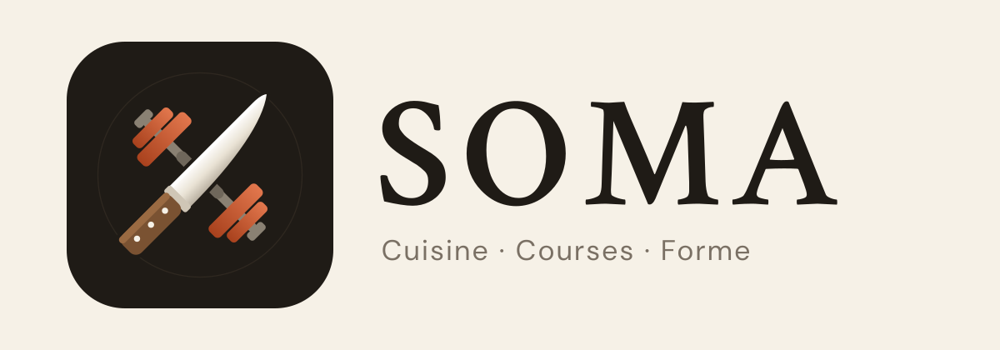

<p align="center"></p>

# SOMA

*Livre de cuisine et lifestyle.*

Application de cuisine du quotidien construite à partir de **La Gutxunomie** d'Enzo Rochel : recettes, planning des repas, liste de courses et placard.

Aucun serveur ni compte n'est nécessaire. SOMA est une page web (PWA) installable sur iPhone ou Android, et elle fonctionne hors ligne. Les données restent sur l'appareil.

## Fonctionnalités (v1)

- **Recettes** : les 98 fiches de La Gutxunomie (71 complètes, 12 brouillons, 15 à compléter). On peut chercher par nom ou par ingrédient, filtrer par catégorie, marquer des favoris, ajuster le nombre de portions (les quantités sont recalculées), cocher les étapes en mode cuisine (l'écran reste allumé), modifier une recette ou en créer une.
- **Planning** : midi et soir, semaine par semaine. Il peut suggérer des repas pour les créneaux vides et générer la liste de courses de la semaine.
- **Courses** : les quantités sont additionnées entre recettes et les articles sont triés par rayon. On peut ajouter un article à la main, partager la liste et ranger le panier au placard.
- **Placard** : les stocks, avec leurs dates de péremption (alerte à 3 jours). Les ingrédients déjà au placard ne sont pas ajoutés aux courses. L'onglet propose aussi des recettes faisables avec ce qu'on a.
- **Calories** : une estimation par portion pour chaque plat, calculée à partir de ses ingrédients (`nutrition.js`). Elle est visible sur les fiches et dans le planning (total midi + soir), et on peut trier les recettes par légèreté.
- **Sauvegarde** : export et import d'un fichier JSON.

## Mise en ligne sur GitHub Pages

1. Créer un dépôt `soma` sur GitHub, puis y déposer le contenu de ce dossier (ou `git push`).
2. Aller dans **Settings → Pages → Source : Deploy from a branch**, choisir `main` et `/ (root)`.
3. L'app sera en ligne sur `https://<pseudo>.github.io/soma/`.
4. Sur iPhone, ouvrir ce lien dans Safari, puis **Partager → Sur l'écran d'accueil**.

À chaque mise à jour, changer `VERSION` dans `sw.js` pour que les téléphones récupèrent la nouvelle version.

## Structure

| Fichier | Rôle |
|---|---|
| `index.html` | L'application (HTML, CSS et JS, sans dépendance) |
| `recipes.js` | Les recettes structurées, générées depuis le livre |
| `nutrition.js` | Table des calories moyennes (kcal/100 g, poids d'une pièce, d'une cuillère) |
| `sw.js`, `manifest.webmanifest`, `icon*` | Mode hors-ligne et installation |
| `tools/parse.py` | Convertit l'export Markdown du PDF en données |
| `tools/patch.py` | Corrections manuelles, puis export de `recipes.js` |

Pour régénérer les recettes après une mise à jour du livre :

```bash
python3 tools/parse.py La_Gutxunomie.md tools/recipes.json
python3 tools/patch.py tools/recipes.json recipes.js
```

Les modifications faites dans l'app sont enregistrées par-dessus le livre (sur l'appareil). Pour les rendre permanentes, il faut mettre à jour le livre puis régénérer `recipes.js`.

## Pistes v2

- Synchronisation entre appareils (GitHub Gist ou Supabase)
- Photos des plats
- Minuteurs intégrés aux étapes
- Décompte automatique du placard après une recette cuisinée
